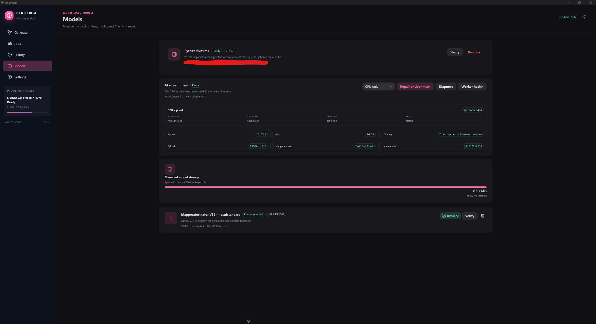
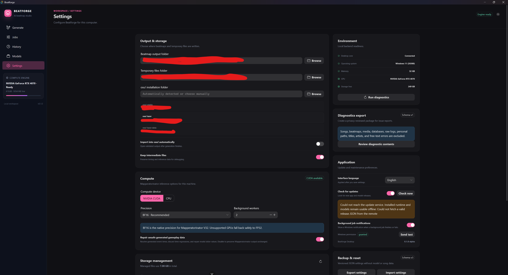
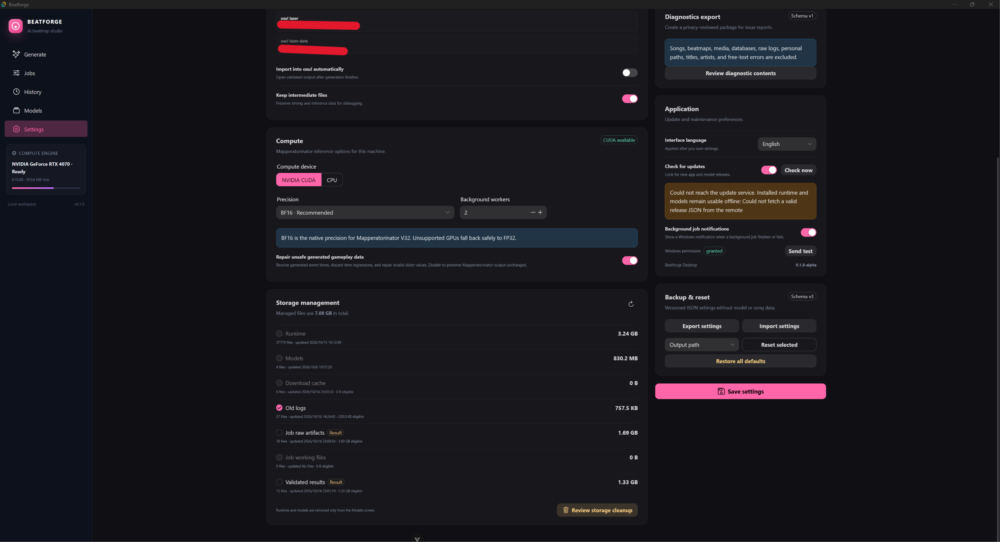
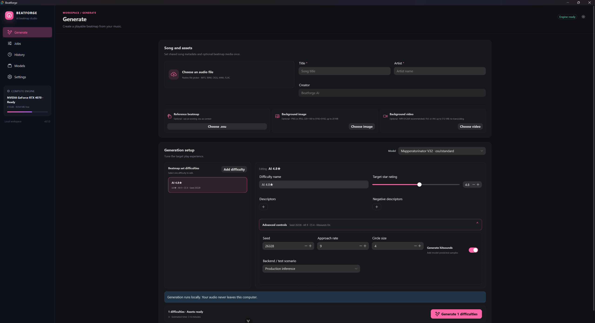
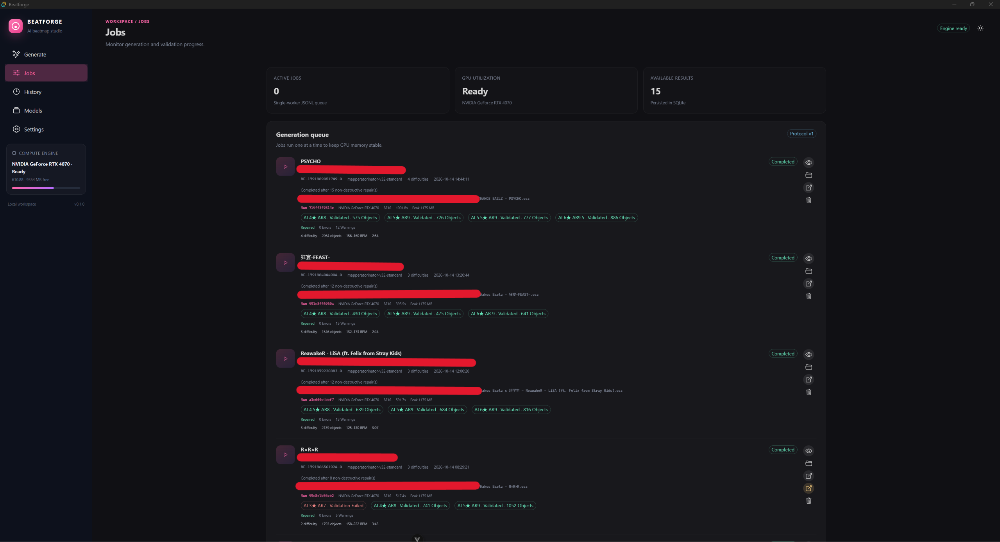
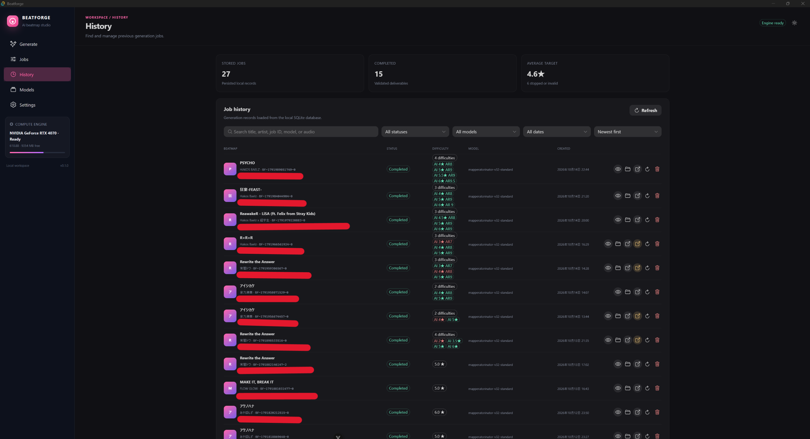

# Beatforge user guide

[繁體中文](guide.zh-TW.md) · [Home](../../README.md)

## Install and prepare

Download the Windows x64 installer from the project's GitHub Releases when a
release is available. Verify its SHA-256 against the accompanying
`SHA256SUMS.txt`. A release marked **Windows Authenticode unsigned** has no
verified Windows Publisher; it may be warned about or blocked under your
system policy. Do not disable Windows protections for this app.

Launch Beatforge and open **Models**. Follow the status and installation or
repair actions for the pinned runtime and Mapperatorinator V32 model. Initial
downloads need a network connection and can take time. The runtime, model,
settings, jobs, and output are stored under the managed app-data directory,
separately from the installed program. Already verified components can be used
offline. See [requirements](requirements.md) if GPU setup is unavailable.

In **Settings**, review the processing device, precision, osu! executable,
automatic import, output options, and language. If osu! is not detected,
select its executable manually. Settings also contains update checks, storage
cleanup, and diagnostic export.

The lower part of **Settings** contains storage cleanup, diagnostic export,
update preferences, and backup/reset controls.

## Create a beatmap draft

1. On **Generate**, choose MP3, WAV, OGG, M4A, or FLAC audio. Enter a title and
   artist. These fields are written to the `.osu` metadata.
2. Optionally choose an existing `.osu` from **the same song** as reference
   context. It is not a general style or pattern reference for a different
   song. You may also add a background image or video; the video **start time**
   moves its start on the beatmap timeline, not the media's internal trim point.
3. Add one or more difficulties. Give each a name and target star rating.
   Advanced controls include seed, descriptors, AR, CS, and predicted
   hitsounds. The target rating is a request to the model, not a guarantee.
4. Select **Generate**. Jobs run one at a time. The **Jobs** page shows progress
   and validation. You can review earlier jobs in **History**.

### New settings in the 0.2.0 development build

The in-development 0.2.0 build adds shared **Creator, Unicode title/artist, song source, and public tags**, plus per-difficulty **HP, OD, base slider multiplier, and slider tick rate** under advanced controls. Check which difficulty is selected before editing its values, then review the summary before submission. These fields are not available in the published 0.1.0 release.

When optional fields are blank, Creator becomes `Beatforge AI`, Unicode title/artist follow the regular title/artist, and Source is empty. Public Tags still include the `Beatforge AI mapperatorinator` disclosure. Without a reference beatmap, HP/OD/slider multiplier/slider tick rate default to `5`/`8`/`1.4`/`1`. With a same-song reference, omitted difficulty values inherit its settings; this was verified with a real generation and osu! playtest. These are base beatmap values and generation settings, not a guarantee of star rating or mapping quality.

Retry after interruption uses the stored original request. Each generated difficulty is checked against its effective metadata and numeric settings before completion; a mismatch prevents a completed result. See the [draft 0.2.0 notes](../release/v0.2.0-release-notes.md) and [draft known limits](../release/v0.2.0-known-issues.md) for scope and remaining checks.

Positive and negative descriptors guide generation style. In the 0.2.0 development build, entering negative descriptors enables stronger model guidance (`cfg_scale=1.5`); leaving them empty retains V32's `1.0`. Descriptors do not guarantee a particular rhythm, object density, or mapping quality.

**Jobs** shows the queue and each difficulty's validation status. **History**
lets you search and reopen previous jobs.

## Review and import

Open the job's preview and validation details. A completed result has passed
Beatforge's structural and safety checks, **not** osu!'s ranking or gameplay
review. Use the import action to hand a copy of the `.osz` to osu!; Beatforge
keeps its managed output. osu! may consume the handoff copy during import.

Some failed jobs offer **Import failed output anyway** or **Import full set
including failed difficulties**. Use these only to inspect and repair the map
in osu!; read the validation errors first. A failed map is not approved for
play or upload. In osu!'s editor, check song sync, timing, hit objects,
hitsounds, difficulty, metadata, and optional media.

## Problems and privacy

- If first setup fails, check free disk space, network access, and the exact
  model/runtime error on **Models**, then use its retry or repair action.
- If CUDA is unavailable or memory is low, close other GPU-heavy apps and
  check the [GPU support summary](requirements.md). CPU mode can be much slower.
- If import fails, verify the osu! executable in **Settings** and use the
  output-folder action to inspect the artifact. Do not delete managed files
  directly while a job is active.
- For a bug report, use **Settings → Diagnostic export**. Review the preview
  and ZIP before sharing. It omits media and beatmap contents by default, but
  you should still check for personal information.

Before publishing an AI-assisted map, read the [sharing guidance](sharing.md).
