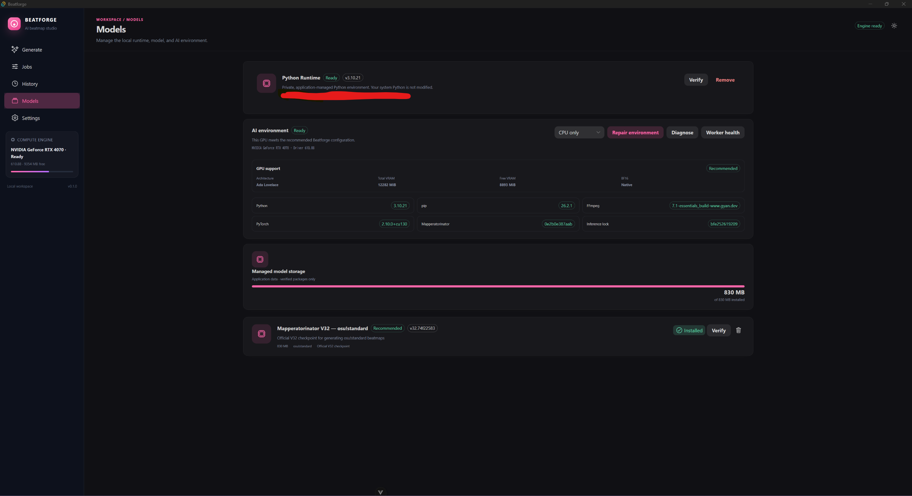
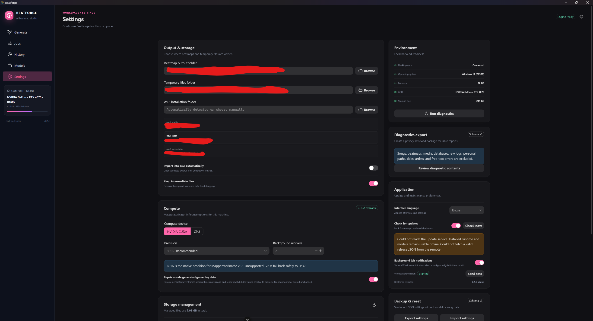
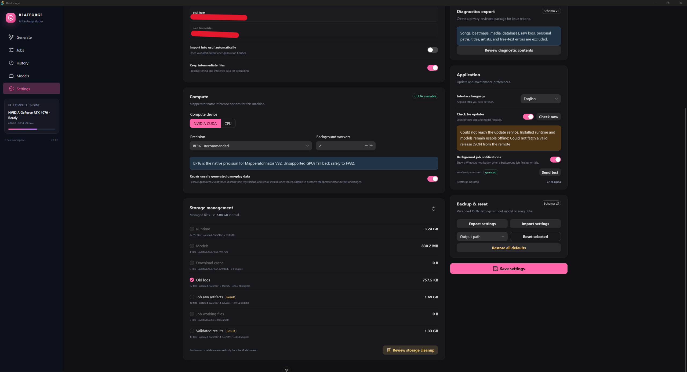
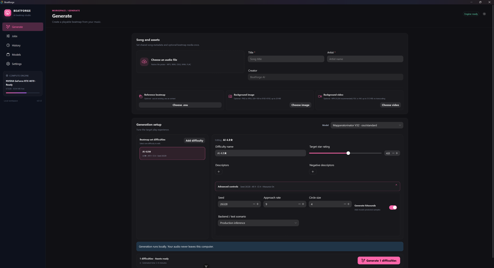
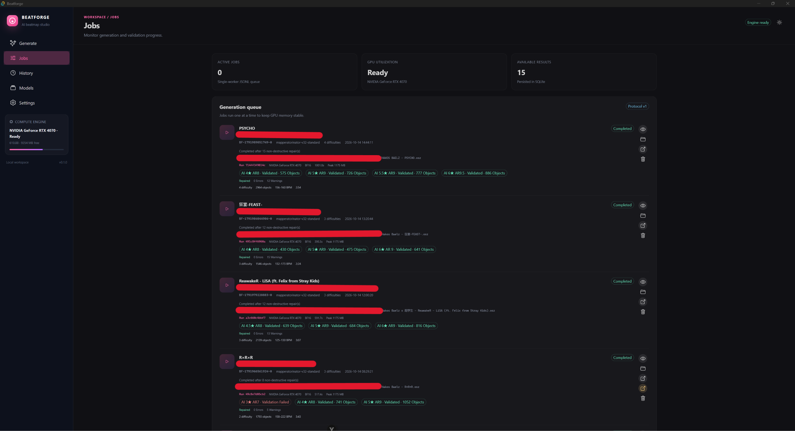
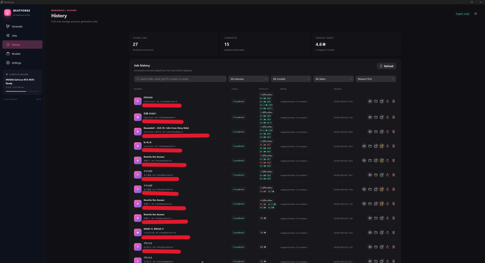

# Beatforge 使用指南

[English](guide.md) · [首頁](../../README.zh-TW.md)

## 安裝與準備

發布版本上線後，從 GitHub Releases 下載 Windows x64 安裝程式，並以隨附的
`SHA256SUMS.txt` 核對 SHA-256。標示 **Windows Authenticode unsigned** 的版本
沒有 Windows 驗證的發行者，系統可能警告或依政策封鎖；不要為本程式關閉 Windows
保護功能。

開啟 Beatforge，前往 **模型** 頁，依狀態提示安裝或修復固定版本的 runtime 與
Mapperatorinator V32 模型。首次下載需要網路，可能花一些時間。Runtime、模型、
設定、任務與輸出位於受管理的 app-data，與安裝的程式分開；已驗證的元件可離線重用。
若 GPU 無法使用，請看[系統需求](requirements.zh-TW.md)。

在 **設定** 檢查運算裝置、精度、osu! 執行檔、自動匯入、輸出選項與語言。如果未偵測到
osu!，可手動指定執行檔。設定頁也提供更新檢查、儲存空間清理與診斷匯出。

**設定**頁下半部可管理儲存空間、匯出診斷資料、設定更新偏好，以及備份或重設設定。

## 產生譜面草稿

1. 在 **生成** 選擇 MP3、WAV、OGG、M4A 或 FLAC 音訊，填入歌曲名稱與演出者；
   這些資訊會寫入 `.osu` metadata。
2. 可選擇**同一首歌**既有的 `.osu` 當參考脈絡；它不是另一首歌的通用風格／
   pattern 參考。也可加入背景圖片或影片。影片的**開始時間**是它在譜面時間軸上
   開始播放的時間，並不是裁切影片內部時間。
3. 新增一個或多個難度，設定名稱與目標星數。進階控制包含 seed、描述詞、AR、CS
   與預測 hitsounds。目標星數是給模型的要求，並非保證值。
4. 按 **生成**。任務一次處理一筆；**任務**顯示進度和驗證結果，**歷史紀錄**可找回舊任務。

**任務**頁會顯示佇列和各難度的驗證狀態；**歷史紀錄**可搜尋並重新開啟舊任務。

## 檢查與匯入

查看預覽和驗證詳情。完成的結果通過的是 Beatforge 的結構／安全檢查，**不是**
osu! 的排名或遊玩品質審核。按匯入會把 `.osz` 的副本交給 osu!；Beatforge 保留
受管理的輸出。osu! 匯入時可能消耗交接副本。

部分失敗任務也提供**仍要匯入失敗輸出**或**匯入包含失敗難度的完整譜面集**。
這只供在 osu! 檢查與修復，請先閱讀驗證錯誤；失敗譜面不代表可直接遊玩或上傳。
在 osu! 編輯器檢查音樂同步、timing、物件、hitsounds、難度、metadata 和媒體。

## 問題處理與隱私

- 首次設定失敗：檢查磁碟空間、網路與 **模型** 頁顯示的錯誤，再重試或使用修復功能。
- CUDA 無法使用或顯存不足：關閉其他大量使用 GPU 的程式，查看
  [GPU 支援摘要](requirements.zh-TW.md)。CPU 模式可能慢很多。
- 匯入失敗：在 **設定** 確認 osu! 執行檔，並用開啟輸出資料夾功能查看成品。
  任務執行中不要直接刪除受管理檔案。
- 回報問題：使用 **設定 → 診斷匯出**。分享前先檢查預覽與 ZIP。預設排除媒體與譜面
  內容，但仍請確認沒有個人資料。

公開 AI 輔助譜面前，請閱讀[分享與上傳說明](sharing.zh-TW.md)。
